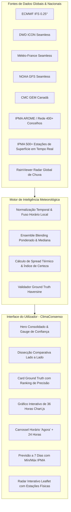

# 🌦️ ClimaConsenso

> **Fusão Meteorológica Multimodelo & Validação Ground Truth em Tempo Real**  
> *Uma aplicação moderna e de alta precisão que combina 6 dos maiores modelos meteorológicos do mundo (ECMWF, GFS, ICON, Météo-France, GEM e IPMA) com validação direta por mais de 500 estações físicas de superfície.*

[](https://github.com/jd164/metereologia/actions/workflows/deploy.yml)
[](https://jd164.github.io/metereologia/)
[](https://vitejs.dev/)
[](https://developer.mozilla.org/pt-PT/docs/Web/JavaScript)
[](https://www.chartjs.org/)
[](https://leafletjs.com/)
[](LICENSE)

---

## 🌐 Demonstração Online

A aplicação está disponível e pronta a usar através do GitHub Pages:  
👉 **[https://jd164.github.io/metereologia/](https://jd164.github.io/metereologia/)**

---

## 💡 A Ideia & Porquê o ClimaConsenso?

As aplicações meteorológicas convencionais baseiam-se habitualmente num **único modelo numérico** (como o GFS americano ou previsões comerciais interpoladas). No entanto, a atmosfera é um sistema caótico não-linear:
* Em regimes marítimos, o **ECMWF** é reconhecido mundialmente pela sua superioridade sinótica.
* Em orografia europeia complexa, o **ICON** (Alemanha) e o **AROME** (Météo-France / IPMA) capturam microclimas locais com maior resolução convectiva.
* Nenhuma aplicação individual acerta sempre, gerando discrepâncias frequentes de 4°C a 7°C entre serviços meteorológicos para a mesma hora.

O **ClimaConsenso** adota a metodologia científica do **Ensemble Weather Forecasting**:
1. Consulta em paralelo múltiplos supercomputadores meteorológicos globais e regionais.
2. Aplica algoritmos de **fusão estatística ponderada** (Weighted Blending) e eliminação de outliers (Mediana).
3. Calcula o **Índice de Certeza do Consenso** (0 a 100%) baseado no desvio padrão ($\sigma$) e na concordância dos modelos.
4. Conecta-se em direto à rede física de **estações meteorológicas de superfície do IPMA** em Portugal, confrontando o que foi previsto com a temperatura e vento reais medidos pelos sensores de solo (*Ground Truth*).

---

## 🏗️ Arquitetura do Sistema



---

## 🔬 Modelos Meteorológicos Integrados

| Modelo | Origem / Instituição | Resolução & Cobertura | Peso Padrão | Foco Principal |
| :--- | :--- | :--- | :---: | :--- |
| **ECMWF IFS** | Centro Europeu (Reading/Bolonha) | ~9 km • Global | **35%** | Considerado o modelo numérico global de maior pontuação e fiabilidade geral. |
| **DWD ICON** | Serviço Meteorológico Alemão | ~2.2 km EU / ~13 km Global | **25%** | Alta resolução para a Europa Central e dinâmica de nuvens convectivas. |
| **Météo-France** | Météo-France (AROME / ARPEGE) | ~2.5 km • Península Ibérica | **20%** | Especialista na Europa Ocidental e dinâmica pirenaica/ibérica. |
| **NOAA GFS** | NCEP / Estados Unidos | ~22 km • Global | **15%** | Elevada taxa de atualização e robustez comprovada para escalas planetárias. |
| **CMC GEM** | Centro Meteorológico Canadiano | ~15 km • Global | **5%** | Ótimo comportamento em sistemas de frentes frias e massas polares atlânticas. |
| **IPMA Oficial** | IPMA (Portugal Continental e Ilhas) | Concelho / AROME 2.5 km | **Destaque** | Previsão horária oficial para mais de 400 concelhos e integração de dados de solo. |

> *Nota: Os pesos dos modelos podem ser calibrados livremente pelo utilizador através do modal interativo de Definições de Pesos, permitindo testar presets como "Foco Europeu", "Consenso Democrático" ou "Ensemble Global".*

---

## ✨ Funcionalidades Principais

### 1. Previsão Consolidada de Consenso (Ensemble Blending)
* Cálculo hora a hora da temperatura ótima através da média ponderada dos modelos normalizados.
* Determinação da mediana estatística para impedir que modelos discrepantes (*outliers*) distorçam o resultado.
* Código meteorológico de síntese com prioridade para eventos de precipitação severa ou chuvisco.

### 2. Índice de Certeza do Consenso (0 a 100%)
* **Score Computado**: Calcula a concordância entre os modelos numéricos com base no desvio padrão ($\sigma$) e no intervalo térmico ($T_{max} - T_{min}$).
* **Categorização Transparente**:
  * 🟢 **Consenso Muito Alto** (Spread < 1.0°C): Probabilidade elevadíssima de acerto.
  * 🔵 **Consenso Alto** (Spread < 2.0°C): Boa convergência entre as simulações.
  * 🟠 **Consenso Moderado** (Spread < 3.5°C): Existência de frentes em transição ou divergência horária.
  * 🔴 **Consenso Baixo / Incerteza Crítica** (Spread ≥ 3.5°C): Modelos discordam fortemente sobre a chegada de massas térmicas.

### 3. Validação Ground Truth em Tempo Real
* Localização da estação meteorológica física oficial do IPMA mais próxima através da **fórmula geodésica de Haversine**:
  $$d = 2R \cdot \arcsin\left(\sqrt{\sin^2\left(\frac{\Delta\phi}{2}\right) + \cos(\phi_1)\cos(\phi_2)\sin^2\left(\frac{\Delta\lambda}{2}\right)}\right)$$
* Comparação da temperatura e vento previstos pelos modelos com os sensores físicos de superfície.
* **Ranking de Precisão em Direto**: Determina qual o modelo com menor margem de erro ($\pm X^\circ\text{C}$) face à realidade do terreno.

### 4. Integração Oficial Completa do IPMA
* **400+ Concelhos de Portugal**: Acesso à previsão horária oficial (`public-data/forecast/aggregate/`) para todas as localidades portuguesas (temperatura, vento, humidade e probabilidade de chuva exatas).
* **Mapeamento Rigoroso de Convenções**: Tratamento correto dos códigos de probabilidade nula (`-99.0` $\rightarrow$ 0% de chuva), garantindo total concordância com o portal do IPMA.
* **Transparência Geográfica**: Distinção clara entre a previsão local do concelho e medições de estações físicas regionais circundantes.

### 5. Gráfico Interativo Multimodelo (Chart.js)
* Visualização sobreposta das trajetórias das próximas 36 horas a começar no momento presente (**Agora**).
* Alternância instantânea entre:
  * 🌡️ **Temperatura (°C)**
  * 🌧️ **Probabilidade de Chuva (%)**
  * 💧 **Precipitação Acumulada (mm)**

### 6. Radar Meteorológico ao Vivo e Rede de Estações (Leaflet + RainViewer)
* Animação em tempo real das nuvens e frentes de precipitação por radar doppler.
* Marcadores interativos no mapa com as mais de 500 estações meteorológicas de superfície ativas em Portugal continental e regiões autónomas.

---

## 🛠️ Tecnologias e Bibliotecas

* **Core**: Vanilla JavaScript (ES Modules), HTML5 semântico, CSS3 Moderno (Glassmorphism, Variáveis CSS, Flexbox/Grid).
* **Bundler & Dev Server**: [Vite 8](https://vitejs.dev/)
* **Gráficos Interativos**: [Chart.js 4](https://www.chartjs.org/)
* **Cartografia & Radares**: [Leaflet 1.9](https://leafletjs.com/)
* **APIs de Dados**:
  * [Open-Meteo Multi-Model API](https://open-meteo.com/) (ECMWF, GFS, ICON, Météo-France, GEM, Geocoding)
  * [IPMA Open & Public Data API](https://api.ipma.pt/) (Previsão de concelhos, estações de superfície, observações horárias)
  * [RainViewer Radar API](https://www.rainviewer.com/api.html) (Mosaico de radar de precipitação por satélite)
* **CI/CD**: GitHub Actions com deploy automático para o GitHub Pages.

---

## 💻 Instalação e Execução Local

### Pré-requisitos
* [Node.js](https://nodejs.org/) versão 18 ou superior
* [npm](https://www.npmjs.com/)

### Passos de Instalação

1. Clone o repositório:
   ```bash
   git clone https://github.com/jd164/metereologia.git
   cd metereologia
   ```

2. Instale as dependências:
   ```bash
   npm install
   ```

3. Inicie o servidor de desenvolvimento local:
   ```bash
   npm run dev
   ```

4. Aceda à aplicação no seu navegador:
   ```text
   http://localhost:5173/
   ```

5. Para gerar os artefactos de produção otimizados:
   ```bash
   npm run build
   ```

---

## 📁 Estrutura do Projeto

```text
metereologia/
├── .github/
│   └── workflows/
│       └── deploy.yml           # Pipeline CI/CD automática para o GitHub Pages
├── dist/                        # Build de produção otimizado para deploy
├── src/
│   ├── api/
│   │   ├── ipma.js              # Cliente oficial IPMA (concelhos, horários, superfície)
│   │   └── openMeteo.js         # Cliente multi-modelo Open-Meteo & geocoding
│   ├── components/
│   │   ├── dailyForecast.js     # Cartões da previsão a 7 dias
│   │   ├── ensembleChart.js     # Gráfico multimodelo Chart.js (36 horas)
│   │   ├── groundTruthCard.js   # Validação física com ranking de sensores
│   │   ├── header.js            # Cabeçalho, barra de pesquisa universal e favoritos
│   │   ├── heroConsensus.js     # Card principal de consenso & gauge radial de certeza
│   │   ├── hourlyForecast.js    # Carrossel horário ("Agora" + 24 horas)
│   │   ├── modelComparison.js   # Comparador lado a lado dos 6 modelos
│   │   ├── radarMap.js          # Radar meteorológico Leaflet + RainViewer
│   │   └── settingsModal.js     # Modal de calibração interativa de pesos dos modelos
│   ├── engine/
│   │   ├── confidence.js        # Algoritmo de cálculo do Índice de Confiança (0-100%)
│   │   ├── ensemble.js          # Motor matemático de fusão (Weighted Blending & Median)
│   │   └── groundTruth.js       # Motor de avaliação e pontuação face aos sensores
│   ├── utils/
│   │   ├── formatters.js        # Formatadores em Português de datas, graus e vento
│   │   ├── storage.js           # Persistência local (favoritos, pesos, localização)
│   │   └── weatherIcons.js      # Gerador de ícones SVG dinâmicos
│   ├── main.js                  # Ponto de entrada e orquestrador reativo da aplicação
│   └── style.css                # Sistema de design completo (Vanilla CSS)
├── index.html                   # HTML5 semântico com meta tags e fontes
├── package.json                 # Configuração de scripts e dependências
├── vite.config.js               # Configuração do Vite com base path relativo para Pages
└── README.md                    # Documentação do projeto
```

---

## 📄 Licença

Este projeto está licenciado sob a Licença MIT - consulte o ficheiro [LICENSE](LICENSE) para mais detalhes.

---

<p align="center">
  Desenvolvido com foco na precisão científica e excelência visual. 🇵🇹 🌦️
</p>
